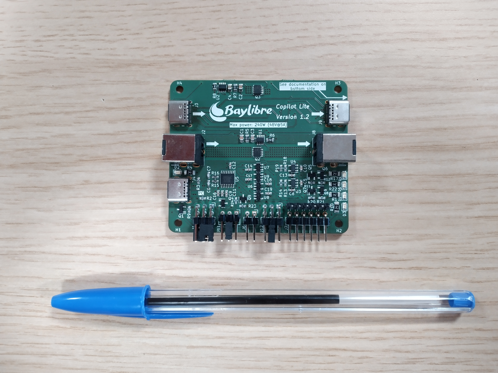

Copilot
=======

Description
-----------

The user documentation is available in the ``doc`` folder.
The generated HTML pages can be viewed `here <https://baylibre.github.io/Copilot/>`_.

The board hardware files are in the ``Copilot_Lite/Hardware`` folder.

The FTDI chip is configured and serialized by the ``Serialization`` software located in the  ``Copilot_Lite/Software`` folder.
The boards serialization and test procedure is described in the ``Copilot_Lite/Factory_Testing.md`` file.

Extension boards
----------------

The Copilot Lite board features some extension boards to be connected on top, like an Arduino Shield or a Raspberry Pi Hat.

More than one extension board can be stacked on top of the Copilot Lite master board, according to the needs.

* `3x USB 2.0 channels <https://github.com/BayLibre/Copilot-extension-triple-usb-2.0>`_, the Copilot Lite GPIOs can drive the channels power.
* `3x signal relays <https://github.com/BayLibre/Copilot_Extension_Triple_Relays>`_, the Copilot Lite GPIOs can close or open each relay.
